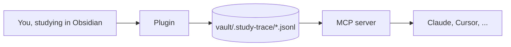

# Study Trace

Records _how_ you work through a note, frame by frame: what you write and change, where you pause, and what you
mark as a question. Any AI agent can read it back over MCP.



Everything stays on your machine.

## What you get back

Ask your agent _"how did my last sitting go?"_ and it reads the sitting as plain frames — no
labels, no scores. The agent decides what a minute-long pause over a wrong answer means.
From a real sitting (more in [examples/agent-view.md](examples/agent-view.md)):

```
## Courses/CS-410 Subnetting Practice.md · Nov 24, 12:07 AM · 5:11 · session obsidian-b9a61cca…
[1:17] “Problem 2 — Which subnet holds 172.16.45.200/20?” · wrote “/20 = 255.255.248.0 so block size $256 - 248 = 8$ in the 3rd octet.”
[1:23] wrote “45 sits in 40–47 → network 172.16.40.0”
[1:23–2:26] 63s without typing · cursor on “45 sits in 40–47 → network 172.16.40.0” 63s · on screen: “CS-410 · Subnetting practice” to “Misses”
[2:27] deleted the line “/20 = 255.255.248.0 so block size $256 - 248 = 8$ in the 3rd octet.”
[2:42] wrote “/20 = 20 bits = 8 + 8 + 4 → 3rd octet $11110000_2 = 240$ → 255.255.240.0, block $256 - 240 = 16$.”
[2:59] wrote “Broadcast = last address in the block: 172.16.47.254”
[3:07] “Broadcast = last address in the block: 172.16.47.254” → “Broadcast = last address in the block: 172.16.47.255”
[4:21] “Problem 3 — VLSM” · marked a question: “do I always give out the biggest subnet first?”
```

Every frame is stamped `m:ss` into the sitting. `get_notes_at` shows the whole note as it stood
at any of them.

## Setup

```bash
pnpm install && pnpm build
```

Plugin into your vault:

```bash
mkdir -p "<vault>/.obsidian/plugins/study-trace"
cp packages/obsidian/dist/main.js packages/obsidian/manifest.json "<vault>/.obsidian/plugins/study-trace/"
```

Turn on **Study Trace** in Settings → Community plugins. Then hook up Claude Code:

```bash
claude mcp add study-trace -- node "$PWD/packages/mcp/dist/index.js" "<vault>/.study-trace"
```

No studying to test with? `pnpm simulate "<vault>"` types three scripted sittings into the real
plugin code on a fake clock.

## Repo

| Package                                  | What's in it                                                |
| ---------------------------------------- | ----------------------------------------------------------- |
| [`packages/core`](packages/core)         | the `Recorder` (edits in, frames out), `timeline` and replay (`notesAt`) |
| [`packages/obsidian`](packages/obsidian) | the plugin, plus the simulator in `sim/`                    |
| [`packages/mcp`](packages/mcp)           | the MCP server                                              |

More: [what it records](docs/what-it-records.md) · [how it fits together](docs/architecture.md)
