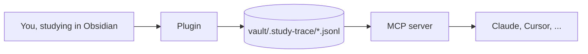

# Study Trace

Watches _how_ you work through a note: where you write, stall, erase, rewrite, and what you
mark as a question. Any AI agent can read it back over MCP.



Everything stays on your machine.

## What you get back

Ask your agent _"how did my last sitting go?"_ and it reads something like this:

```
### Oct 27, 6:00 PM · 1:12 · CS-410 Midterm Practice.md (obsidian-test)
arc: first words → stuck → picked it back up → asked → rewrote · 2 edits
- 0:52 stuck · “Classless IPv4 (CIDR)” — cursor parked 47s, then asked for help
- 0:52 asked · “Classless IPv4 (CIDR)” — “is my network address right?”
- 1:12 rewrote · “Classless IPv4 (CIDR)” — rewrote “40 because 45 rounds do…” as “32: blocks start at mul…”
```

Every moment is timestamped (`m:ss` into the sitting) and listed in order.

## Setup

```bash
pnpm install && pnpm build
```

Plugin into your vault:

```bash
mkdir -p "<vault>/.obsidian/plugins/study-trace"
cp packages/obsidian/dist/main.js packages/obsidian/manifest.json "<vault>/.obsidian/plugins/study-trace/"
```

Turn on **Study Trace** in Settings → Community plugins. Then hook up Claude Code:

```bash
claude mcp add study-trace -- node "$PWD/packages/mcp/dist/index.js" "<vault>/.study-trace"
```

No studying to test with? `pnpm simulate "<vault>"` types three scripted sittings into the real
plugin code on a fake clock.

## Repo

| Package                                  | What's in it                                                |
| ---------------------------------------- | ----------------------------------------------------------- |
| [`packages/core`](packages/core)         | the `Recorder` (edits in, moments out) and replay (`notesAt`) |
| [`packages/obsidian`](packages/obsidian) | the plugin, plus the simulator in `sim/`                    |
| [`packages/mcp`](packages/mcp)           | the MCP server                                              |

More: [what it records](docs/what-it-records.md) · [how it fits together](docs/architecture.md)
