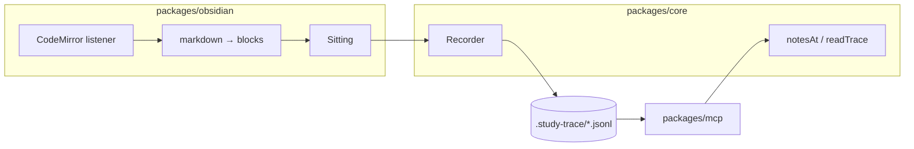

# How it fits together

**Capture.** The plugin listens to the editor. On every typing pause it parses the note into
blocks (one per line; code and `$$` math blocks whole) and hands them to the `Recorder`, along
with keystrokes, cursor moves, the visible lines and window focus.

**Record.** The `Recorder` diffs blocks against the last pause and writes one `act` per changed
block, and a `quiet` frame for every stretch of 10 s+ without typing. No labels, no thresholds
on what "stuck" means: that's the reader's call. It's pure: no DOM, no timers, no files.

**Read.** `timeline()` renders a sitting as plain frames; `notesAt` replays the note to any
moment. The MCP server serves both.

## Block ids

Markdown has no block ids, so `reconcile()` in [`markdown.ts`](../packages/obsidian/src/markdown.ts)
carries them across edits:

- unchanged block → keeps its id
- changed block between two unchanged ones → treated as an edit, not delete + create

Weak spot: an insert right next to an edit can get paired the wrong way round. Fine for notes.

## Pull, not push

MCP only answers when you ask. A tutor that taps you on the shoulder when you stall would have to
live in the plugin.

## Next

1. Use it on real sittings; see if agents read the frames well. Detectors (fast, deterministic)
   can come back later, on the read side, without changing what's recorded.
2. A tutor pane inside Obsidian.
3. Other editors (VS Code, Notion) feeding the same `Recorder`.
