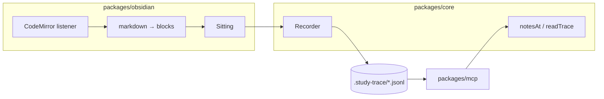

# How it fits together

**Capture.** The plugin listens to the editor. On every typing pause it parses the note into
blocks (headings, lines, list items, code, math) and hands them to the `Recorder`.

**Record.** The `Recorder` diffs blocks against the last pause, writes one `act` per changed
block, and fires moments. It's pure: no DOM, no timers, no files. Easy to test, easy to reuse
for another editor.

**Read.** The MCP server loads the JSONL, sorts by `seq`, and can replay the note to any
moment with `notesAt`.

## Block ids

Markdown has no block ids, so `reconcile()` in [`markdown.ts`](../packages/obsidian/src/markdown.ts)
carries them across edits:

- unchanged block → keeps its id
- changed block between two unchanged ones → treated as an edit, not delete + create

Weak spot: an insert right next to an edit can get paired the wrong way round. Fine for notes.

## Pull, not push

MCP only answers when you ask. A tutor that taps you on the shoulder when you stall would have to
live in the plugin.

## Next

1. Use it on real sittings, tune `STUCK_MS` and erase sizes.
2. A tutor pane inside Obsidian.
3. Other editors (VS Code, Notion) feeding the same `Recorder`.
